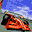

# Flag To Flag

## DC Saves - flag2flag

| Icon | Filename | VMU File | Description |
|------|----------|----------|-------------|
|  | [v59453.zip](v59453.zip){: .btn .btn-purple } | `SEGACART.SYS` | Todos los autos y el super speed mode. |
|  | [v81874.zip](v81874.zip){: .btn .btn-purple } | `SEGACART.SYS` | its a start |
|  | [v90922.zip](v90922.zip){: .btn .btn-purple } | `SEGACART.SYS` | todos los varros y mas secretos |
|  | [v54673.zip](v54673.zip){: .btn .btn-purple } | `SEGACART.SYS` | Five extra cars, extra camera angle, Super Speed Mode(60fps) |
|  | [v97020.zip](v97020.zip){: .btn .btn-purple } | `SEGACART.SYS` | Won champ mode, Unlocked pace car and super fast race...Hey its not much, but its something for this game..... |
|  | [v81960.zip](v81960.zip){: .btn .btn-purple } | `SEGACART.SYS` | Todos los autos, y el super speed mode. Dudas:arcadelac@hotmail.com |
|  | [v46911.zip](v46911.zip){: .btn .btn-purple } | `SEGACART.SYS` | [Japanese] Everything completed. |
