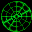

# Incoming

## DC Saves - incoming

| Icon | Filename | VMU File | Description |
|------|----------|----------|-------------|
|  | [v30743.zip](v30743.zip){: .btn .btn-purple } | `INCOMING.001` | this is a perfect save whit everithing done.All the 10 missions done.Tudo completo este e o save que todos procuram. |
|  | [v19449.zip](v19449.zip){: .btn .btn-purple } | `INCOMING.001` | This gets you to the third mission. I hope you find it helpful. |
|  | [00000378.zip](00000378.zip){: .btn .btn-purple } | `INCOMING.001` | SCENARIO 03 starts in scenario 3 |
