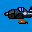

# Iron Aces

## DC Saves - ironaces

| Icon | Filename | VMU File | Description |
|------|----------|----------|-------------|
|  | [v91038.zip](v91038.zip){: .btn .btn-purple } | `IRONACES.G12` | todos avioes no hard.all planes.BRASIL!RUMO AO HEXA!CAMPEAO MUNDIAL!I LOVE YOU LISI! |
|  | [v5139.zip](v5139.zip){: .btn .btn-purple } | `IRONACES.G00` | all planes on last mission |
|  | [v42319.zip](v42319.zip){: .btn .btn-purple } | `IRONACES.G09` | played through on hard |
|  | [v63890.zip](v63890.zip){: .btn .btn-purple } | `IRONACES.G04` | all planes and missions on hard |
|  | [v6897.zip](v6897.zip){: .btn .btn-purple } | `IRONACES.G00` | Start out on Level 7. |
|  | [v64562.zip](v64562.zip){: .btn .btn-purple } | `IRONACES.G12` | All planes available. Played through on normal. |
|  | [v89766.zip](v89766.zip){: .btn .btn-purple } | `IRONACES.G00` | On the 3rd mission. |
