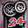

# Test Drive Le Mans

## DC Saves - lemans

| Icon | Filename | VMU File | Description |
|------|----------|----------|-------------|
|  | [v74387.zip](v74387.zip){: .btn .btn-purple } | `TDLEMANS.OPT` | todos modos abilitados todos carros todas fases |
|  | [v21789.zip](v21789.zip){: .btn .btn-purple } | `TDLEMANS.001` | All unlocked and 20 hours into a 24hour LeMans race |
|  | [v49179.zip](v49179.zip){: .btn .btn-purple } | `TDLEMANS.001` | Todas las pistas, todos los autos desbloqueados.Faltan 5 minutos para completar las 24hs de Le Mans.Trata de batir los tiempos. |
|  | [v62691.zip](v62691.zip){: .btn .btn-purple } | `TDLEMANS.001` | tudo de tudo completo. com 23 horasda corrida de 24 horas completo,e 11 voltas na frente do segundode valor a seu pais!!! |
|  | [v6000.zip](v6000.zip){: .btn .btn-purple } | `TDLEMANS.OPT` | All cars opened, all tracks opened. Everything complete! |
|  | [v35838.zip](v35838.zip){: .btn .btn-purple } | `TDLEMANS.001` | On the final lap of the 24hr Le Mans race using the Jaguar prototype. 3 laps ahead of the 2nd place car. Easy finish! |
|  | [v16699.zip](v16699.zip){: .btn .btn-purple } | `TDLEMANS.001` | All time trails, quickraces, and championships completed. |
|  | [v42683.zip](v42683.zip){: .btn .btn-purple } | `TDLEMANS.001` | 15 Hours into a 24hour race Expert mode. Everything unlocked. |
|  | [v38692.zip](v38692.zip){: .btn .btn-purple } | `TDLEMANS.OPT` | All quick races won, all but one championship race won. |
|  | [v36820.zip](v36820.zip){: .btn .btn-purple } | `TDLEMANS.OPT` | All tracks, all but two championshipscompleted, time trials almost complete.Many unlocked cars. |
|  | [v40738.zip](v40738.zip){: .btn .btn-purple } | `TDLEMANS.001` | 24 hours complete. All game modes complete, all cars. |
|  | [v73041.zip](v73041.zip){: .btn .btn-purple } | `TDLEMANS.001` | 41 carros disponiveis, todas as pistas e todos os modos completados modo 24,06,01 e 10 minutos completados, feitos pelo pH DO BRASIL>feitos pe. |
|  | [v8626.zip](v8626.zip){: .btn .btn-purple } | `TDLEMANS.OPT` | All races finished eccept the real 24hour Le mans race. |
|  | [v70785.zip](v70785.zip){: .btn .btn-purple } | `TDLEMANS.001` | Part 3 the last of the saved game files. This should be all you need to have all but 2 of the cars in the game. |
|  | [v36893.zip](v36893.zip){: .btn .btn-purple } | `TDLEMANS.001` | All track and cars unlocked even all the time trial race are beaten, The only cars that aren't gotten is the 24 hour race cars.  enjoy!! |
|  | [v13162.zip](v13162.zip){: .btn .btn-purple } | `TDLEMANS.OPT` | All quick race and championships unlocked...3 of 10 time trials completed...10min and 1hr le man's completed...21 cars available, all tracks... |
|  | [v31243.zip](v31243.zip){: .btn .btn-purple } | `LEMANS24.OPT` | Loads of cars and tracks 4 hours into 24 hour race Please download both saves Part 1 of 2 |
|  | [v82547.zip](v82547.zip){: .btn .btn-purple } | `LEMANS24.001` | Loads of cars and tracks. 4 hours into 24 hour race. Part 2 of 2 |
|  | [v72767.zip](v72767.zip){: .btn .btn-purple } | `TDLEMANS.OPT` | Some tracks a few extra cars and Uncle Chuckie and Hensley modes. |
|  | [v8375.zip](v8375.zip){: .btn .btn-purple } | `TDLEMANS.OPT` | All races in quick race mode finished! Jaguar unlocked |
|  | [v91547.zip](v91547.zip){: .btn .btn-purple } | `TDLEMANS.OPT` | All the tracks plus several cars unlocked. |
|  | [LEMANS24.zip](LEMANS24.zip){: .btn .btn-purple } | `LEMANS24.OPT` | All unlocked. |
