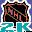

# Sega Sports NHL 2K

## DC Saves - nhl2k

| Icon | Filename | VMU File | Description |
|------|----------|----------|-------------|
|  | [v67813.zip](v67813.zip){: .btn .btn-purple } | `SEGANHL2KP00` | new flyers...dopita..fedetenko..and the like (fedoruk) |
|  | [v41034.zip](v41034.zip){: .btn .btn-purple } | `SEGANHL2KR00` | new rosters and some dynamic creadted players |
|  | [v62214.zip](v62214.zip){: .btn .btn-purple } | `SEGANHL2KR00` | complete flyers team as of 01-01-02 |
|  | [v70236.zip](v70236.zip){: .btn .btn-purple } | `SEGANHL2KR00` | Rosters as of 01-26-01. |
|  | [v90806.zip](v90806.zip){: .btn .btn-purple } | `SEGANHL2KR00` | Updated rosters as of 11/2.  This file is more up to date than my last one. |
|  | [v9750.zip](v9750.zip){: .btn .btn-purple } | `SEGANHL2KR00` | Updated rosters as of 10/10.  I have tried to update the rosters as best as I can, but I may have missed some of the trades and free agent signings.  Keep in mind that it is impossible to have completely updated rosters because the Minnesota Wil |
|  | [v39355.zip](v39355.zip){: .btn .btn-purple } | `SEGANHL2KR00` | NHL 2k rosters 7/25/00 |
|  | [00000503.zip](00000503.zip){: .btn .btn-purple } | `SEGANHL2KR00` | NHL 2K Rosters as of 2/15/2000. |
