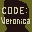

# Resident Evil: Code Veronica

## DC Saves - resident_evil

| Icon | Filename | VMU File | Description |
|------|----------|----------|-------------|
|  | [v49956.zip](v49956.zip){: .btn .btn-purple } | `RE_CV000.001` | On disk 2 with inf. herbs and magnum. Also all weapoms with 999 ammo. |
|  | [v33626.zip](v33626.zip){: .btn .btn-purple } | `RE_CV000.SYS` | All game modes avaliable, linear and rocket weapons avaliable and all characters. |
|  | [v43934.zip](v43934.zip){: .btn .btn-purple } | `RE_CV000.005` | Infinate rocket launcher, plenty of herbs and f-aid sprays. About 70% through the first disk. I hope u enjoy it. |
|  | [v89183.zip](v89183.zip){: .btn .btn-purple } | `RE_CV000.005` | ALL MODES,BATTLE MODE WESKER PLAYABLE END OF GAME AT WHERE FIRST RE TOOK PLACE  TELL ME WHAT YOU THINK OF IT |
|  | [v58348.zip](v58348.zip){: .btn .btn-purple } | `RE_CV000.015` | The best save take this and you will be satisfied towards the beginning with Claire look inside the chest it has EVERYTHING! |
|  | [v39417.zip](v39417.zip){: .btn .btn-purple } | `RE_CV000.001` | Just before the fight in the plane. You got 999 ammo for the pistol, 14 sprays, 17 mixed herbs, infinite linear launcher, infinite magnum, infinite ink ribbon and mp-100 fully loaded. This save is not hacked, I play and catch a lot of things, d |
|  | [v65733.zip](v65733.zip){: .btn .btn-purple } | `RE_CV000.001` | Everything unlocked! All weapons and infinite ammo! |
|  | [v70045.zip](v70045.zip){: .btn .btn-purple } | `RE_CV000.004` | Unlimited rocket launcher (not linear launcher) unlocked for main game. |
|  | [v84106.zip](v84106.zip){: .btn .btn-purple } | `RE_CV000.002` | the tyrant battle on the plane |
|  | [v20350.zip](v20350.zip){: .btn .btn-purple } | `RE_CV000.001` | EVERYTHING UNLOCKED BATTLE GAME IS ALL DONE GOT SERECT CHARACTERS TOO! |
|  | [v33557.zip](v33557.zip){: .btn .btn-purple } | `RE_CV000.003` | PLAY AS WESKER!!!! Open up the storage box. Oh yeah don't get hit by bats! |
|  | [v60781.zip](v60781.zip){: .btn .btn-purple } | `RE_CV000.001` | Start with Claire with infinite magnun, linear launcher & ink ribbon. |
|  | [v63276.zip](v63276.zip){: .btn .btn-purple } | `RE_CV000.001` | Start on first disk and play as tyrant.This will only work if you have a gamesharkin and then start game without codes. |
|  | [v42832.zip](v42832.zip){: .btn .btn-purple } | `RE_CV000.002` | Start of Disc 2. Enjoy. |
|  | [v12495.zip](v12495.zip){: .btn .btn-purple } | `RE_CV000.012` | Be a special person starting from the first disk! AHAHAHAHAH Its really cool! e-mail me if you want more to play as others!<a href="mailto:widkidzzz@yahoo.com">widkidzzz@yahoo.com!</a> we will trade vmu files! |
|  | [v64920.zip](v64920.zip){: .btn .btn-purple } | `RE_CV000.001` | Ultimate, gameshark enhanced save!All weapons fully loaded (most w/999 bullets) and mad mixed herbs.You even get to play with the sniperrifle & linear launcher!Saved right before the final battle!Enjoy!!!! |
|  | [v69325.zip](v69325.zip){: .btn .btn-purple } | `CDX_SETTINGS` | Download this for infinity everything!!! |
|  | [v77209.zip](v77209.zip){: .btn .btn-purple } | `RE_CV000.002` | on disk 2 with cris redfield check your item box! |
|  | [v12018.zip](v12018.zip){: .btn .btn-purple } | `RE_CV000.003` | Check this huge box full of weapons and infinite herbs!!! |
|  | [v43618.zip](v43618.zip){: .btn .btn-purple } | `RE_CV000.003` | Right before final boss with HEAVY firepower. Magnum(18), Assault Rifle(70%), 100% Submachine Guns, 10 explosive arrows, Grenade launcher(lots of grenades). |
|  | [v81216.zip](v81216.zip){: .btn .btn-purple } | `RE_CV000.002` | when you get to the first save point you have a bazzoka with inf ammo |
|  | [v61271.zip](v61271.zip){: .btn .btn-purple } | `RE_CV000.SYS` | Question what does all A's in battle gameequal linear launcher!!!!!!! |
|  | [v62187.zip](v62187.zip){: .btn .btn-purple } | `RE_CV000.SYS` | battle mode unlocked |
|  | [v41499.zip](v41499.zip){: .btn .btn-purple } | `RE_CV000.015` | here it is retep, hope it helpd ya |
|  | [v22475.zip](v22475.zip){: .btn .btn-purple } | `RE_CV000.SYS` | Battle game with linear luancher |
|  | [v46677.zip](v46677.zip){: .btn .btn-purple } | `RE_CV000.013` | start game with wesker RE1! |
|  | [v52935.zip](v52935.zip){: .btn .btn-purple } | `RE_CV000.SYS` | All characters and weapons includingthe Linear Launcher unlocked. |
|  | [v52407.zip](v52407.zip){: .btn .btn-purple } | `RE_CV000.001` | Start of the game with a Magnum withinfinite ammo and an infinite mixedherb. All the weapons with infiniteammo in the first item box. |
|  | [v84865.zip](v84865.zip){: .btn .btn-purple } | `RE_CV000.002` | End of the game with all the weapons and items in the items box. |
|  | [v81176.zip](v81176.zip){: .btn .btn-purple } | `RE_CV000.SYS` | PERFECT BATTLE MODE |
|  | [00000886.zip](00000886.zip){: .btn .btn-purple } | `RE_CV000.001` | End of the game. When you get to Alexia, hold UP when close to her and hit her SIX times with the G.Launcher, she'll die, I guarentee! |
|  | [biocsys1.zip](biocsys1.zip){: .btn .btn-purple } | `VERONICA.SYS` | System Save! All secrets open! |
|  | [bioc001.zip](bioc001.zip){: .btn .btn-purple } | `VERONICA.004` | Last Save! |
|  | [v12022.zip](v12022.zip){: .btn .btn-purple } | `RE_CV000.SYS` | Save for start of game. You have special gun and infinite ammo. |
