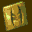

# Shadow Man

## DC Saves - shadowman

| Icon | Filename | VMU File | Description |
|------|----------|----------|-------------|
|  | [v1056.zip](v1056.zip){: .btn .btn-purple } | `SHADOMAN.000` | 120 dark souls,todos cadeaux todos segredos.tudo aberto ate o book of shadows todas as armas. . |
|  | [v67545.zip](v67545.zip){: .btn .btn-purple } | `SHADOMAN.000` | this is good save for person that start this game.man ta nimehai in bazi pish raftam vali badbakhtane rahi peida nakardam. |
|  | [v92438.zip](v92438.zip){: .btn .btn-purple } | `SHADOMAN.000` | The actual game file save. Everything beaten. Need to DL this one and the other one to get all levels, cheats & movies. |
|  | [v49533.zip](v49533.zip){: .btn .btn-purple } | `SHADOMAN.SYS` | game beaten with everything unlocked |
|  | [v7967.zip](v7967.zip){: .btn .btn-purple } | `SHADOMAN.SYS` | algunos cheats de este gran juego |
|  | [v98125.zip](v98125.zip){: .btn .btn-purple } | `SHADOMAN.000` | All 120 dark souls, 98 cardeux (only2 remaining), most cheats, most cutscenes, plus Book of Shadows. Enjoy! |
|  | [v78723.zip](v78723.zip){: .btn .btn-purple } | `SHADOMAN.002` | 120 dark souls and secret Book of Shadows.  Most cheats unlocked. |
|  | [v6915.zip](v6915.zip){: .btn .btn-purple } | `SHADOMAN.000` | FINAL BATTLE & SUPER FORCE |
|  | [v94384.zip](v94384.zip){: .btn .btn-purple } | `SHADOMAN.000` | Everything beat |
|  | [v75146.zip](v75146.zip){: .btn .btn-purple } | `SHADOMAN.000` | This is saved right before the final battle with Legion. All abilities gained, as well as all cardeux & dark souls. Not every secret, tho', some bug ate some of them. Enjoy the ones that are there! |
|  | [v8737.zip](v8737.zip){: .btn .btn-purple } | `ICONDATA_VMS` | Shadowman Voodo Teddy bear VMU icon. |
