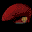

# Soldier of Fortune

## DC Saves - soldierfortune

| Icon | Filename | VMU File | Description |
|------|----------|----------|-------------|
|  | [v73246.zip](v73246.zip){: .btn .btn-purple } | `SFORTUNE.001` | save bookstore2 |
|  | [v71043.zip](v71043.zip){: .btn .btn-purple } | `SFORTUNE.000` | THE ENDCOMPLETE 100% |
|  | [v83904.zip](v83904.zip){: .btn .btn-purple } | `SFORTUNE.000` | on the first CD end its a good save ><><>< no final do primeiro CD e' um bom save |
|  | [v87032.zip](v87032.zip){: .btn .btn-purple } | `SFORTUNE.000` | You start off in the steer right behind the shop right after finishing iraq and Hawk is killed. Something is wrong with my game and I can see Sam so I could'nt get past hereif you download this and get please upload it and e-mail me.Pretty good |
|  | [v70360.zip](v70360.zip){: .btn .btn-purple } | `SFORTUNE.000` | end game |
|  | [v98601.zip](v98601.zip){: .btn .btn-purple } | `SFORTUNE.000` | germany 3-3 |
|  | [v88901.zip](v88901.zip){: .btn .btn-purple } | `SFORTUNE.000` | want to see the end? |
|  | [v82590.zip](v82590.zip){: .btn .btn-purple } | `SFORTUNE.000` | jogo tudo aberto fazes armas |
|  | [v4171.zip](v4171.zip){: .btn .btn-purple } | `SFORTUNE.000` | esto te lleva a Sudan 1-3...Buena Suerte ;P |
|  | [v23806.zip](v23806.zip){: .btn .btn-purple } | `SFORTUNE.000` | last boss in level hard. |
|  | [v52854.zip](v52854.zip){: .btn .btn-purple } | `SFORTUNE.002` | jogo terminado com todos os'secrets' abertos!!! |
|  | [v87746.zip](v87746.zip){: .btn .btn-purple } | `SFORTUNE.000` | mision en ciberia buen estado |
|  | [v68732.zip](v68732.zip){: .btn .btn-purple } | `SFORTUNE.000` | DESAFIO FINAL NO LEVEL MAIS DIFICIL (challenging) TENTE ZERAR ESTE GAME |
|  | [v18388.zip](v18388.zip){: .btn .btn-purple } | `SFORTUNE.002` | This is the complete game up to germany, end boss pretty Near or in the end boss, i'm not suremost of the game passed with the "Pig Sticker", all Ammo. |
|  | [v64385.zip](v64385.zip){: .btn .btn-purple } | `CDX_CODES_00` | This is a gameshark file. It gives you unlimited armor,bullets, and best of all there is no reload. |
|  | [v32174.zip](v32174.zip){: .btn .btn-purple } | `SFORTUNE.000` | I got to the Tokyo level, and cannot get any further, let me know if you anyone gets past it or has trouble downloading. |
|  | [v50094.zip](v50094.zip){: .btn .btn-purple } | `SFORTUNE.DAT` | This is the best save you'll get for this game on last boss with very great weapons. |
|  | [v53207.zip](v53207.zip){: .btn .btn-purple } | `SFORTUNE.000` | last mission easy level |
