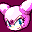

# Sonic Shuffle

## DC Saves - sonicshuffle

| Icon | Filename | VMU File | Description |
|------|----------|----------|-------------|
|  | [v58859.zip](v58859.zip){: .btn .btn-purple } | `SSHUFFLE.DAT` | all pic bought, all 8 characters, game fully beaten. |
|  | [v61627.zip](v61627.zip){: .btn .btn-purple } | `SSHUFFLE.DAT` | All hidden characters in VS Mode |
|  | [v98575.zip](v98575.zip){: .btn .btn-purple } | `SONICSHUFFLE` | All characters unlocked. |
|  | [v20598.zip](v20598.zip){: .btn .btn-purple } | `SSHUFFLE.DAT` | ALL the goodies open |
|  | [SONICEX.zip](SONICEX.zip){: .btn .btn-purple } | `SSHUFFLE.DAT` | Sonic Shuffle Best Save |
