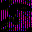

# Spec Ops: Omega Squad

## DC Saves - specopsomega

| Icon | Filename | VMU File | Description |
|------|----------|----------|-------------|
|  | [v68899.zip](v68899.zip){: .btn .btn-purple } | `SO-OMEGA_001` | 100% complete. I have reached highest rank of General! |
|  | [v66330.zip](v66330.zip){: .btn .btn-purple } | `SO-OMEGA_001` | Most of Antarctica completed |
|  | [v53099.zip](v53099.zip){: .btn .btn-purple } | `SO-OMEGA_001` | First level passed. |
|  | [v18635.zip](v18635.zip){: .btn .btn-purple } | `SO-OMEGA_001` | It is completed 100% and this is not a joke so please try it |
|  | [v35028.zip](v35028.zip){: .btn .btn-purple } | `SO-OMEGA_001` | About 1/2 complete. You will die many times Grasshoppa. But that's okay, you'll come back as a recruit! Worse things could happen I suppose. |
