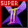

# Super Street Fighter 2X

## DC Saves - ssf2x

| Icon | Filename | VMU File | Description |
|------|----------|----------|-------------|
|  | [ssf2x001.zip](ssf2x001.zip){: .btn .btn-purple } | `SSF2X___.SYS` | Power Bar Always MAX! |
|  | [SSF2X.zip](SSF2X.zip){: .btn .btn-purple } | `SSF2X___.SYS` | Everything unlocked, including DIP Switch Menu! |
|  | [v70779.zip](v70779.zip){: .btn .btn-purple } | `SSF2X___.SYS` | jogue com gouki no arcade mode sobre ryu pressione start+SR+SM+SF.pronto gouki ja esta selecionavel |
|  | [pfighter.zip](pfighter.zip){: .btn .btn-purple } | `SSF2X___.SYS` | Perfect Save! All Secret Open! |
