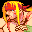

# Street Fighter 3: Double Impact

## DC Saves - streetfight3di

| Icon | Filename | VMU File | Description |
|------|----------|----------|-------------|
|  | [v50554.zip](v50554.zip){: .btn .btn-purple } | `STF3_D_I.DAT` | Everything opened, extra options, Shin Gouki, Gill and records at parryng attack!!! |
|  | [v21939.zip](v21939.zip){: .btn .btn-purple } | `STF3_D_I.DAT` | Shin Akuma & Gill open hold start onAkuma & press a button for Shin Akuma. |
|  | [v68968.zip](v68968.zip){: .btn .btn-purple } | `STF3_D_I.DAT` | play as shin akuma and play as gill |
|  | [v75558.zip](v75558.zip){: .btn .btn-purple } | `STF3_D_I.DAT` | everything unlocked.shin Akuma: at selection screen go toAkuma and hold start and press anykick or punch buttons. |
|  | [v88846.zip](v88846.zip){: .btn .btn-purple } | `STF3_D_I.DAT` | OPENING ALL SECRETS & CHARACTERS |
|  | [v33370.zip](v33370.zip){: .btn .btn-purple } | `STF3_D_I.DAT` | OPTION EXTRA ALL CLEAR |
