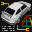

# Test Drive V-Rally

## DC Saves - vrally

| Icon | Filename | VMU File | Description |
|------|----------|----------|-------------|
|  | [v26860.zip](v26860.zip){: .btn .btn-purple } | `TDVRALLY_GAM` | Tudo detonado nesse jogasso, todas pistas, carros e um carro bonus. Voce nao vai se arrepender! |
|  | [v17157.zip](v17157.zip){: .btn .btn-purple } | `TDVRALLY_GAM` | this is good save.you have many cars.dar in save nimi az bazi takmil shodeh. |
|  | [v28938.zip](v28938.zip){: .btn .btn-purple } | `TDVRALLY_GAM` | All cars and tracks open . |
|  | [v59944.zip](v59944.zip){: .btn .btn-purple } | `TDVRALLY_GAM` | All cars and all championshipsopen, and you can put your nameas driver,if is not open go tothe progression screen and pushthe (a) button over the smallscreens. |
|  | [v97468.zip](v97468.zip){: .btn .btn-purple } | `_VRALLY2_GAM` | Everything clear: Arcade,v-rally trophy,championship,{european,world,expert}.All bonus cars and the stunning fullmotion video unlocked,{press the A button inthe last bonus car,in the progressionscreen,to see it}. |
|  | [v93443.zip](v93443.zip){: .btn .btn-purple } | `TDVRALLY_GAM` | All levels beaten, all cars attained. AND, as a VERY special bonus, a quite long movie of rally driver Ari Vatanen driving the Peugeot 405 T 16 up Pikes Peaks. The year is 1988. If you are a rally fan, then you LOVE this footage!!! |
|  | [v91867.zip](v91867.zip){: .btn .btn-purple } | `TDVRALLY_GAM` | First two levels of each mode beatenand six cars unlocked. All tracks availableto race in time trial mode. |
