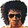

# Zombie Revenge

## DC Saves - zombie

| Icon | Filename | VMU File | Description |
|------|----------|----------|-------------|
|  | [v30965.zip](v30965.zip){: .btn .btn-purple } | `ZOMBIE_U_001` | red blood, extra option, free play mode, tranning mode |
|  | [v91226.zip](v91226.zip){: .btn .btn-purple } | `ZOMBIE_U_001` | TUDO LIBERADO |
|  | [v26491.zip](v26491.zip){: .btn .btn-purple } | `ZOMBIE_U_001` | Everything unlocked |
|  | [v97447.zip](v97447.zip){: .btn .btn-purple } | `ZOMBIE_U_001` | Unlimited continues & Infinite life, as well as red blood. Change blood color & # of continues in the options mode. The infinite life is for Original Mode only. |
|  | [ZOMBIERE.zip](ZOMBIERE.zip){: .btn .btn-purple } | `ZOMBIE_U_SYS` | Best Save! Everything Unlocked! |
